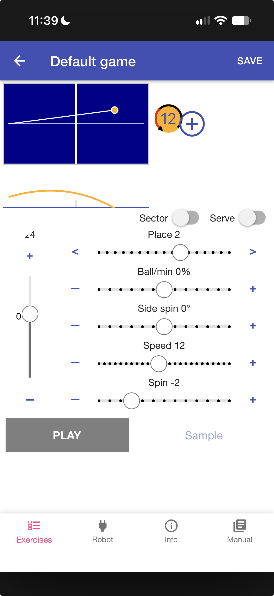

# Amicus BLE

A web app to control a Butterfly Amicus table tennis robot over Bluetooth Low Energy (BLE).
It is a rebuild of the official Amicus Android app: exercises, sequences, robot control,
calibration and wait mode. It runs in the browser, so no app store install is needed.

**Live app: <https://amicus.vaneyghen.be>**



## Why a web app?

- **Works on any device.** It runs in a web browser: Android, iPhone, iPad, Windows, macOS,
  Linux and ChromeOS. The official app is Android only.
- **Nothing to install.** Open the link and connect. On iOS you only need the free Bluefy
  browser (see below).
- **Always up to date.** A reload gets the newest version.
- **Same exercise files.** It reads and writes the `.amicusgame` files of the official app,
  so you can share exercises between the two apps.

## Bugs of the official app that this app fixes

The official Android app (1.3.2) has a number of bugs. This app avoids them:

- **Search opens the wrong exercise.** In the official app, a tap on a search result can
  open a different exercise.
- **Reordered exercises are lost.** A drag in the list is not saved. Here it is saved
  immediately.
- **Sharing changes the stored exercise.** The official app removes data from your own
  exercise when you share it.
- **"Mirror left/right" is not saved.** The official app does not mark the exercise as
  changed, so the mirror is lost. Here it is saved like any other change.
- **Sequences change when you edit an exercise.** "Save to Sequence" stores a link to the
  open exercise, not a copy. Here the sequence gets its own copy.
- **Stale sequences play after a reconnect.** The official app can start an old sequence
  from the robot memory without uploading the new one. Here the upload is reset on each
  connect.
- **The noise filter of the serve sound trigger is ignored.** Here the saved setting is used.
- **Cycle settings show wrong values.** The official app swaps the maximum time and repeat
  values, and accepts values out of range (for example "Play 0 secs"). Here all values stay
  in range.
- **Imported exercises without an ID crash the app.** Here a new ID is made on import.
- **Commands and replies get lost.** Two requests for the same command at the same time,
  silent timeouts, and old data from a dropped connection can confuse the official app.
  Here every reply is matched to its request, timeouts are reported, and the receive
  buffer is cleared on each connect.

The full list, with source references, is in section 6 of
[`docs/APK_SPEC.md`](docs/APK_SPEC.md).

Firmware updates are not part of this app. Use the official app for a firmware update.

## Use the app

The app uses Web Bluetooth. Open <https://amicus.vaneyghen.be>, go to the **Robot** tab
and connect to your robot.

| Platform | Browser |
|---|---|
| Android | Chrome |
| Windows, macOS, Linux, ChromeOS | Chrome or Edge |
| iOS / iPadOS | [Bluefy – Web BLE Browser](https://apps.apple.com/app/bluefy-web-ble-browser/id1492822055) (free) |

**iOS:** Safari and the other iOS browsers do not support Web Bluetooth.
Install the free [Bluefy](https://apps.apple.com/app/bluefy-web-ble-browser/id1492822055)
app from the App Store, then open <https://amicus.vaneyghen.be> in Bluefy.

## Bluetooth protocol

The full BLE protocol (GATT UUIDs, frame format, ball encoding, all commands) is in
[`PROTOCOL.md`](PROTOCOL.md). It was reverse engineered from the official Android app.

If you are an AI assistant or a developer who wants to talk to the robot: start with
[`PROTOCOL.md`](PROTOCOL.md). [`docs/APK_SPEC.md`](docs/APK_SPEC.md) describes the
behaviour of the official app in detail (screens, defaults, timing) and lists
corrections to the protocol file in section 9.

## Repository layout

| Path | Contents |
|---|---|
| `web/` | The web app (static HTML, CSS and JavaScript, no build step) |
| `web/js/ble.js` | Web Bluetooth connection and protocol code |
| `PROTOCOL.md` | BLE protocol reference |
| `docs/APK_SPEC.md` | Specification of the official Android app |
| `amicus.py` | Minimal Python command line controller (uses `bleak`) |
| `wrangler.jsonc` | Cloudflare deploy config |

## Run locally

Web Bluetooth needs a secure context (`https://` or `localhost`):

```bash
cd web
python3 -m http.server 8000
# open http://localhost:8000
```

## Python controller

```bash
pip install bleak
python amicus.py info
python amicus.py play --speed 12 --spin 5 --place 8 --bpm 40 --seconds 20
python amicus.py stop
```

## Deploy

The `web/` folder is served as static assets by Cloudflare at `amicus.vaneyghen.be`:

```bash
npx wrangler deploy
```

## Disclaimer

This is an unofficial project. It is not affiliated with or endorsed by Butterfly.
